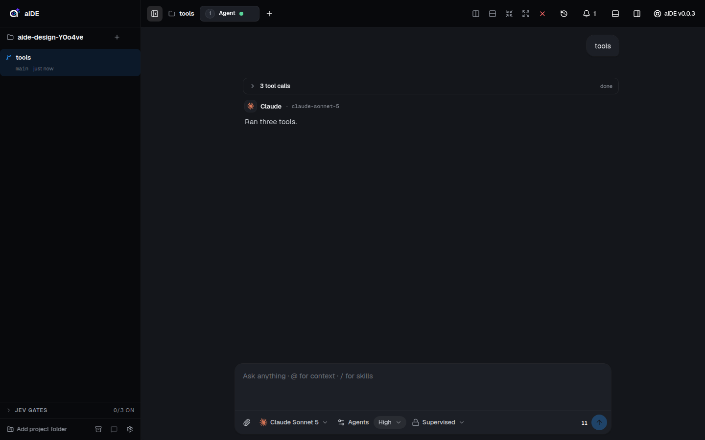
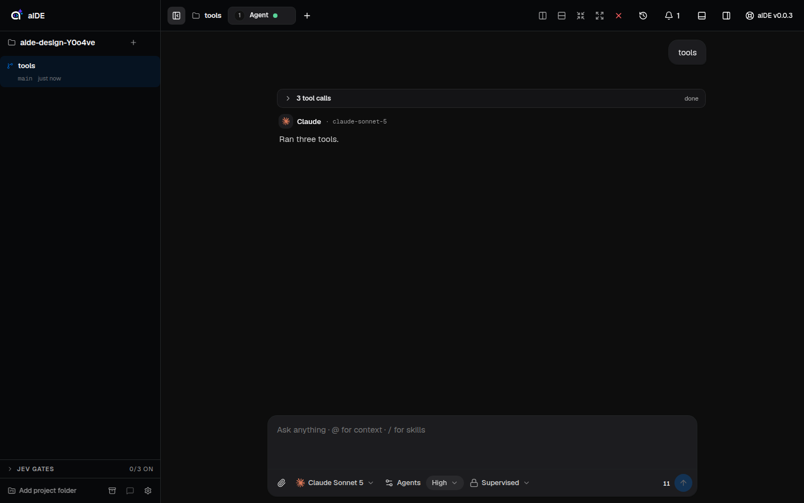
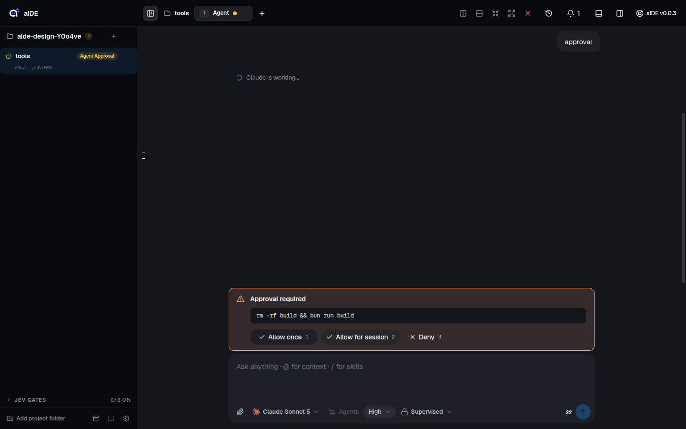
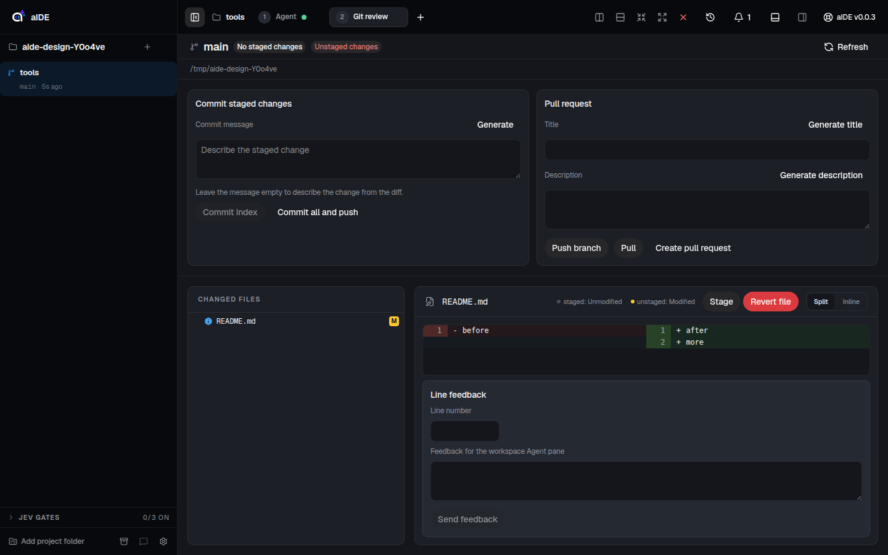
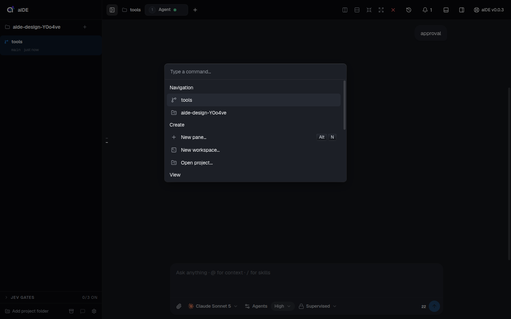
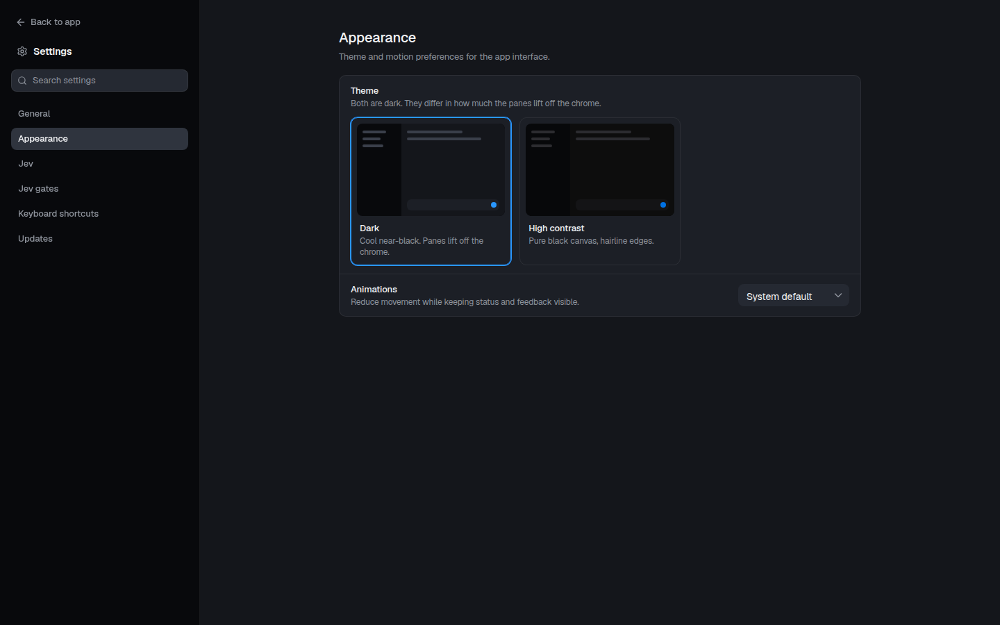

# aide design

This file describes the interface aide ships today. Every value comes from `src/renderer/src/styles.css` or from the component that uses it. If the two disagree, styles.css wins and this file is wrong.

`bun run test:design-tokens` fails when this file names a custom property that styles.css does not define, or when styles.css defines one this file never names. CI runs it. So when you add, rename or delete a token, update the matching table here in the same change.

## Screenshots

Captured from a development build at 1440x900 with the fake agent provider.

| | |
|---|---|
|  |  |
| Agent pane, Dark palette | Agent pane, High contrast palette |
|  |  |
| Approval card | Git review pane |
|  |  |
| Command palette (Ctrl+K) | Settings > Appearance |

## Themes

aide is dark only. There are two palettes, picked in Settings > Appearance > Theme and stored in `localStorage` under `aide.theme` (`src/renderer/src/lib/theme-preference.ts`).

- **Dark** is the default. It lives in `:root[data-palette="dark"]` and overrides part of `:root`. A cool near-black canvas with a lighter surface ladder, so panes read as raised without needing hairlines.
- **High contrast** is the plain `:root` block. A pure black canvas, almost flat surfaces, and solid hairlines doing the separating.

A light theme is planned in ENG-2674 and has not shipped. Nothing in this file describes it. When it lands, it gets its own column in the tables below.

Settings > Appearance > Animations sets `data-motion` on the root element. `data-motion="reduced"` is covered under Motion.

## Color

Each table lists the Dark value, the High contrast value, and what the token is for. A Dark cell reading "same" means the dark palette does not override it.

### Canvas and text

| Token | Dark | High contrast | Role |
|---|---|---|---|
| `--background` | `#08090c` | `#07080a` | App canvas behind panes and the top bar. |
| `--foreground` | `#f2f3f5` | `#f4f4f6` | Primary text and icons. |
| `--body` | `#c4c8ce` | `#cdcdcd` | Paragraph text in transcripts (`.prose p`, `.prose li`), keycap labels, idle composer tools. |
| `--body-muted` | `#c4c8ce` | `#cccccc` | Softer body text. Has a `text-body-muted` utility. Nothing reads it today. |
| `--charcoal` | `#c4c8ce` | `#d3d3d4` | Nothing reads it today. |
| `--muted-foreground` | `#8e939c` | `#9c9c9d` | Secondary text: labels, timestamps, eyebrows, inactive tabs, list markers. |
| `--ash` | `#8e939c` | `#6a6b6c` | Dim text. Also the dot for a stopped session. |
| `--stone` | `#5a606a` | `#434345` | Dimmest text. Also the dot for a session with no known state. |
| `--on-dark-mute` | same | `rgba(255, 255, 255, 0.72)` | Nothing reads it today. |

### Surfaces

Two ladders exist. The four-step ladder is what new components use. The named surfaces feed HeroUI and older components.

| Token | Dark | High contrast | Role |
|---|---|---|---|
| `--surface-1` | `#14161b` | `#141416` | First step up from the canvas: resting buttons (`.btn-surface`), overview cards, code blocks, hover on rows and tabs. |
| `--surface-2` | `#1c1f26` | `#1c1c1f` | Second step: the composer, active tabs and pills, hover on `.btn-icon` and `.row-hover`, inline code. |
| `--surface-3` | `#252932` | `#242427` | Third step: top of the keycap gradient. |
| `--surface-4` | `#2f343e` | `#2c2c30` | Highest step. |
| `--surface` | `#14161b` | `#0d0d0d` | Pane body, and the inset blocks inside cards (approval command, diff box). |
| `--surface-foreground` | `#f2f3f5` | `#f4f4f6` | Text on `--surface`. |
| `--surface-secondary` | `#1c1f26` | `#101111` | Hover on sidebar rows and small icon buttons. Table headers in prose. |
| `--surface-secondary-foreground` | `#f2f3f5` | `#f4f4f6` | Text on `--surface-secondary`. |
| `--surface-tertiary` | `#252932` | `#121212` | Hover on the sidebar project menu button. |
| `--surface-tertiary-foreground` | `#f2f3f5` | `#f4f4f6` | Text on `--surface-tertiary`. |
| `--card` | `#1c1f26` | `#0d0d0d` | Card background. Nothing reads it today. |
| `--card-foreground` | `#f2f3f5` | `#f4f4f6` | Text on cards. Nothing reads it today. |
| `--popover` | `#1c1f26` | `#0d0d0d` | Menus, popovers and dialogs (`.floating-surface`). |
| `--popover-foreground` | `#f2f3f5` | `#f4f4f6` | Text on popovers. |
| `--overlay` | `#1c1f26` | `#101111` | HeroUI overlay background. |
| `--overlay-foreground` | `#f2f3f5` | `#f4f4f6` | Text on overlays. |
| `--secondary` | `#1c1f26` | `#101111` | HeroUI secondary button fill. |
| `--secondary-foreground` | `#f2f3f5` | `#f4f4f6` | Text on secondary buttons. Nothing reads it today. |
| `--muted` | `#1c1f26` | `#101111` | HeroUI muted fill. |
| `--accent` | `#1c1f26` | `#101111` | HeroUI accent fill. A neutral surface, despite the name. |
| `--accent-foreground` | `#f2f3f5` | `#f4f4f6` | Text on `--accent`. |
| `--accent-soft-foreground` | `#f2f3f5` | `#f4f4f6` | HeroUI soft accent text. |

### Interactive color

Blue marks the one thing you can act on. Dark uses a single bright blue for fill, focus and links. High contrast uses a deeper fill blue and keeps the bright blue for links and the caret.

| Token | Dark | High contrast | Role |
|---|---|---|---|
| `--primary` | `#2997ff` | `#0066cc` | Primary buttons, the send button, the active workspace tint (12% alpha), the composer focus ring, the global focus outline. |
| `--primary-foreground` | `#06121f` | `#ffffff` | Text and icons on `--primary`. |
| `--primary-focus` | `#2997ff` | `#0071e3` | Hover fill of `.btn-primary`, focus outline of `.cta-pill`. |
| `--primary-on-dark` | `#2997ff` | `#2997ff` | Links in transcripts, the text caret, active composer tools. |
| `--ring` | `#2997ff` | `#0071e3` | HeroUI and Tailwind focus rings. |
| `--focus` | `#2997ff` | `#0071e3` | HeroUI focus color. |

### State accents

These belong to session activity: state dots, workspace badges, approval and error cards. Chrome never uses them. Every accent has a `-soft` partner at 14 to 15% alpha for backgrounds behind the solid color.

| Token | Dark | High contrast | Role |
|---|---|---|---|
| `--accent-blue` | same | `#57c1ff` | Running or connecting session (pulsing dot). |
| `--accent-blue-soft` | `rgba(87, 193, 255, 0.14)` | `rgba(87, 193, 255, 0.15)` | Background behind blue. |
| `--accent-green` | same | `#59d499` | Ready session, completed fleet tasks, finished workspace setup. |
| `--accent-green-soft` | `rgba(89, 212, 153, 0.14)` | `rgba(89, 212, 153, 0.15)` | Background behind green. |
| `--accent-yellow` | same | `#ffc533` | Session waiting on you. Its 3% tint marks sidebar rows awaiting approval or input. |
| `--accent-yellow-soft` | `rgba(255, 197, 51, 0.14)` | `rgba(255, 197, 51, 0.15)` | Background behind yellow. |
| `--accent-red` | `#ff6b6b` | `#ff6161` | Errors, the danger ghost button. Its 3% tint marks a sidebar row in error. |
| `--accent-red-soft` | `rgba(255, 107, 107, 0.14)` | `rgba(255, 97, 97, 0.15)` | Error card background, danger ghost hover. |
| `--accent-purple` | same | `#bd93ff` | A plan is ready to review. |
| `--accent-purple-soft` | same | `rgba(189, 147, 255, 0.15)` | Background of a plan-ready sidebar row and badge. |
| `--accent-peach` | same | `#ffb084` | Approval card border and icon. |
| `--accent-peach-soft` | same | `rgba(255, 176, 132, 0.14)` | Approval card background. |
| `--accent-ochre` | same | `#e8b94a` | Meant for awaiting input. Nothing reads it today. Sidebar rows use `--accent-yellow`. |
| `--accent-ochre-soft` | same | `rgba(232, 185, 74, 0.14)` | Background behind ochre. Nothing reads it today. |
| `--destructive` | `#ff6b6b` | `#ff6161` | Error text and destructive menu items. |
| `--destructive-foreground` | same | `#000000` | Text on a destructive fill. Nothing reads it today. |
| `--brand-claude` | same | `#d97757` | Claude's mark keeps its brand orange. Every other provider mark is monochrome. |

### Lines

| Token | Dark | High contrast | Role |
|---|---|---|---|
| `--border` | `rgba(255, 255, 255, 0.07)` | `#242728` | Default 1px edge: inactive panes, cards, inputs, pane headers, table cells. |
| `--border-soft` | `rgba(255, 255, 255, 0.07)` | `rgba(255, 255, 255, 0.08)` | Quieter edge: inline code, code blocks. |
| `--border-strong` | `rgba(255, 255, 255, 0.14)` | `rgba(255, 255, 255, 0.16)` | The active pane's edge, hover edges on cards and surface buttons, the ring around floating surfaces. |
| `--input` | `rgba(255, 255, 255, 0.07)` | `#242728` | Input edge. Nothing reads it today. Fields use `--field-border`. |
| `--separator` | `rgba(255, 255, 255, 0.07)` | `#242728` | HeroUI separator. |

### Fields

HeroUI reads these for text inputs and selects.

| Token | Dark | High contrast | Role |
|---|---|---|---|
| `--field-background` | `#1c1f26` | `#101111` | Field fill. |
| `--field-foreground` | `#f2f3f5` | `#f4f4f6` | Field text. |
| `--field-placeholder` | `#8e939c` | `#9c9c9d` | Placeholder text. |
| `--field-border` | `rgba(255, 255, 255, 0.07)` | `#242728` | Field edge. |
| `--field-radius` | same | `0.5rem` | Field corner radius. |
| `--field-shadow` | same | `0 0 0 0 transparent inset` | No field shadow. |

### Sidebar

The sidebar paints itself with `--sidebar`, the surface ladder and `--primary`. Nothing reads the other sidebar tokens today.

| Token | Dark | High contrast | Role |
|---|---|---|---|
| `--sidebar` | `#08090c` | `#07080a` | Sidebar fill. Same as the canvas. |
| `--sidebar-foreground` | `#f2f3f5` | `#f4f4f6` | Sidebar text. |
| `--sidebar-primary` | `#2997ff` | `#0066cc` | Sidebar primary color. |
| `--sidebar-primary-foreground` | `#06121f` | `#ffffff` | Text on `--sidebar-primary`. |
| `--sidebar-accent` | `#14161b` | `#0d0d0d` | Sidebar accent fill. |
| `--sidebar-accent-foreground` | `#f2f3f5` | `#f4f4f6` | Text on `--sidebar-accent`. |
| `--sidebar-border` | `rgba(255, 255, 255, 0.07)` | `#242728` | Sidebar edge. |
| `--sidebar-ring` | `#2997ff` | `#0071e3` | Focus ring inside the sidebar. |

### Keycap gradient

| Token | Dark | High contrast | Role |
|---|---|---|---|
| `--key-bg-start` | `#2f343e` | `#121212` | Start of a keycap gradient. `.keycap` paints from `--surface-3` to `--surface-1` instead. Nothing reads it today. |
| `--key-bg-end` | `#252932` | `#0d0d0d` | End of the same gradient. Nothing reads it today. |

### Syntax highlighting

Shiki's css-variables theme reads these at runtime (`src/renderer/src/lib/highlighter.ts`). Both palettes share them, and the colors follow GitHub's dark theme.

| Token | Value | Role |
|---|---|---|
| `--shiki-foreground` | `var(--foreground)` | Plain code text. |
| `--shiki-background` | `transparent` | The code block's own surface shows through. |
| `--shiki-token-comment` | `#6a737d` | Comments. |
| `--shiki-token-constant` | `#79b8ff` | Constants and numbers. |
| `--shiki-token-function` | `#b392f0` | Function names. |
| `--shiki-token-keyword` | `#f97583` | Keywords. |
| `--shiki-token-link` | `#dbedff` | Links. |
| `--shiki-token-parameter` | `#ffab70` | Parameters. |
| `--shiki-token-punctuation` | `#e1e4e8` | Punctuation. |
| `--shiki-token-string` | `#9ecbff` | Strings. |
| `--shiki-token-string-expression` | `#85e89d` | Template expressions. |

### Tailwind utilities

The `@theme inline` block turns color tokens into Tailwind utilities. Each one is `var()` of the token with the same name minus `color-`, so `--color-surface-2` gives you `bg-surface-2`, `text-surface-2` and `border-surface-2`, all following the active palette.

```
--color-background  --color-foreground
--color-card  --color-card-foreground  --color-popover  --color-popover-foreground
--color-primary  --color-primary-foreground  --color-primary-on-dark  --color-primary-focus
--color-secondary  --color-secondary-foreground  --color-muted  --color-muted-foreground
--color-accent  --color-accent-foreground
--color-destructive  --color-destructive-foreground
--color-border  --color-input  --color-ring
--color-sidebar  --color-sidebar-foreground  --color-sidebar-primary
--color-sidebar-primary-foreground  --color-sidebar-accent
--color-sidebar-accent-foreground  --color-sidebar-border  --color-sidebar-ring
--color-accent-blue  --color-accent-blue-soft  --color-accent-red  --color-accent-red-soft
--color-accent-green  --color-accent-green-soft  --color-accent-yellow  --color-accent-yellow-soft
--color-accent-purple  --color-accent-purple-soft  --color-accent-peach  --color-accent-peach-soft
--color-accent-ochre  --color-accent-ochre-soft
--color-surface-1  --color-surface-2  --color-surface-3  --color-surface-4
--color-surface  --color-surface-secondary  --color-surface-tertiary
--color-body  --color-body-muted  --color-ash  --color-stone
--color-brand-claude
```

## Typography

Two families, both bundled through `@fontsource-variable`, so the app never depends on what the machine has installed.

| Token | Value |
|---|---|
| `--font-sans` | Geist Variable, then the system UI font |
| `--font-mono` | Geist Mono Variable, then JetBrains Mono, then the system monospace |

`body` sets 14px, line-height 1.5, letter-spacing -0.01em, ligatures and kerning on, and antialiased smoothing. There are no font-size tokens. The sizes below are the ones components use.

| Size | Weight | Where |
|---|---|---|
| 10px | 600 | Composer section labels (uppercase, 0.18em tracking), mono shortcut digits on approval buttons. |
| 11px | 600 | `.eyebrow` (uppercase, 1.2px tracking, `--muted-foreground`), pane tabs in the top bar. |
| 12px | 400 to 500 | `.keycap`, `.system-notice`, Tailwind `text-xs` for meta lines and inline commands. |
| 12.5px | 400 | Code inside `.prose pre`, line-height 1.6. |
| 13px | 500 to 600 | `.composer-tool` (500), workspace names in the sidebar (600), menu rows. |
| 14px | 400 to 600 | Base UI text, card titles (600). |
| 15px | 400 | `.prose` transcript text (line-height 1.6, -0.006em) and the composer textarea (line-height 1.5). |
| 1em to 1.25em of 15px | 600 | `.prose` h3, h2, h1, with -0.018em tracking and line-height 1.3. |

`.display` sets weight 600 and -0.3px tracking for headings that need to stand out.

## Spacing

styles.css defines no spacing tokens. Components use Tailwind's default 4px step. The values that come up most:

- 16px (`p-4`): padding inside a pane frame when more than one pane shows.
- 12px by 16px (`py-3 px-4`): approval card and composer textarea padding.
- 8px by 12px: sidebar workspace row (`py-2 pl-3`), with 40px on the right for its hover actions.
- 5px by 8px with a 6px gap: `.composer-tool`.
- 48rem (`max-w-3xl`): the transcript, approval card and composer all share this width, centered in the pane.

One layout token exists:

| Token | Value | Role |
|---|---|---|
| `--pane-header-h` | `40px` | Height of every pane header and of the sidebar project row, so their bottom edges line up across the window. `e2e/pane-header-alignment.spec.ts` guards it. |

## Radii

`@theme inline` replaces Tailwind's radius scale, so `rounded-md` means `--radius-md` and so on.

| Token | Value | Where |
|---|---|---|
| `--radius-xs` | `4px` | Keycaps, the focus outline. |
| `--radius-sm` | `6px` | Menu and list box rows. |
| `--radius-md` | `8px` | Popovers, menus, tooltips, the command palette, composer tools, sidebar rows, buttons. |
| `--radius-lg` | `10px` | Pane frames, the approval card, code blocks. |
| `--radius-xl` | `16px` | Modal dialogs, the workspace switcher. |
| `--radius-pill` | `9999px` | Pills (see below). |
| `--radius` | `0.5rem` | HeroUI's base radius. Matches `--radius-md`. |

HeroUI rounds overlays to 24px and their rows to 16px on its own. styles.css overrides that for `.popover`, `.select__popover`, `.dropdown__popover`, `.tooltip`, `[cmdk-root]` and `[data-model-selector-menu]` (8px), and for `.menu-item` and `.list-box-item` (6px).

## Elevation

Depth comes from the surface ladder first: canvas, then `--surface` for panes, then `--surface-1` and `--surface-2` for things inside them. In Dark each step is visibly lighter. In High contrast the steps are close and `--border` does the work. There are no shadow tokens. Three recipes cover everything that floats:

- **Floating surface** (`.floating-surface`) for popovers, menus and dialogs. `--popover` fill, a 1px inner highlight on the top edge at 6% white, a `0 8px 24px -8px` black shadow at 70%, and a 1px `--border-strong` ring.
- **Composer.** A 1px `--border` ring plus a 2px black shadow at rest. While focused, the ring turns `--primary` and the shadow grows to `0 8px 24px -12px`.
- **Active card.** `.overview-card.is-active` swaps its border to `--primary` and adds a matching 1px ring. On hover it lifts 1px.

## Motion

| Token | Value | Use |
|---|---|---|
| `--t-fast` | `140ms cubic-bezier(0.22, 0.61, 0.36, 1)` | Color, background, border and shadow changes on every interactive utility class, composer tools, transcript links. |
| `--t-base` | `200ms cubic-bezier(0.22, 0.61, 0.36, 1)` | Nothing reads it today. |
| `--ease-out-strong` | `cubic-bezier(0.23, 1, 0.32, 1)` | Entrances and size changes: turns, drawers, settings, the sidebar tree, button presses. |

Durations in use:

| Duration | What moves |
|---|---|
| 140ms | Hover and color changes (`--t-fast`). |
| 150ms / 220ms | Terminal drawer height, closing / opening. Only the height animates. |
| 160ms | Button press: every button scales to 0.97. Conversation minimap ticks and preview. |
| 180ms | Settings page fade and slide. Fleet drawer opacity. |
| 200ms | Expanded sidebar tree slide. |
| 240ms | A new transcript turn fades in and rises 6px. Fleet drawer width and slide, on `cubic-bezier(0.32, 0.72, 0, 1)`. |
| 3s, looping | `.sidebar-working-shimmer`, a white sweep at 2 to 4% opacity across a working workspace row. |
| 2s, looping | `.thinking-shimmer`, a `--foreground` highlight sweeping across `--muted-foreground` text while the model reasons. Off under `prefers-reduced-motion`. |

With `data-motion="reduced"`, every animation stops, and transitions shrink to opacity and color only at 100ms. Turns, the settings page, the sidebar tree and button presses stop moving. The minimap also honors `prefers-reduced-motion`.

## Components

### Pane

A pane is a workspace's unit of work: agent, terminal, editor, git review, preview. `getPaneFrameClassName` in `src/renderer/src/lib/pane-frame.ts` builds its frame.

- A sole pane fills the canvas with `--surface` and has no border or radius.
- With several panes, each frame is `--radius-lg`, 16px padding, `--surface` fill, and a 1px `--border` edge. The active pane's edge is `--border-strong`. Nothing else changes, so focus reads without a color shift.
- A pane header is `--pane-header-h` tall with a bottom `--border` and 20px side padding (Git review, Preview).
- Top bar pane tabs are 11px semibold with a `--radius-md` corner and a state dot. Inactive tabs use `--muted-foreground` and fill with `--surface-secondary` on hover.

Session state dots are 8px circles: `--accent-blue` pulsing while running or connecting, `--accent-yellow` waiting, `--accent-green` ready, `--accent-red` error, `--ash` stopped, `--stone` unknown (`src/renderer/src/lib/session-state-dot.ts`).

### Sidebar row

Two row types in `SidebarTree.tsx`:

- **Project row.** `--pane-header-h` tall, `--radius-md`, 8px side padding, `--surface-secondary` on hover or while a child has focus. Its menu button appears on hover.
- **Workspace row.** `--radius-md`, 8px top and bottom, 12px left. The name is 13px semibold. The branch and age line under it is mono and muted. The active workspace gets a 12% `--primary` tint. Rows without activity fill with `--surface-secondary` on hover.

A workspace row's background also reports agent activity. Error gets a 3% `--accent-red` tint. Pending approval and awaiting input get a 3% `--accent-yellow` tint, plus a yellow badge ("Agent Approval" in the approval screenshot). Working or connecting runs the shimmer. Plan ready fills with `--accent-purple-soft`.

### Pill

`--radius-pill` marks the main action in a group, not every button.

- The main action in a flow uses HeroUI `Button` with `rounded-pill`: "Allow once" on the approval card, and "Open project" on the empty workspace, padded 11px by 22px.
- `.composer-tool.is-pill` is a toolbar control shown as a chip: the reasoning effort picker, and the Plan mode badge. 6% white fill, 10% on hover, 10px side padding.
- Composer suggestion chips are full-round, 12px semibold, `--primary` text on a 10% `--primary` fill with a 40% `--primary` border.

`.filter-pill` sets colors only (muted, hover to `--surface-1`, active `--surface-2`), and the component supplies the radius. `.cta-pill` and `.text-link-on-dark` exist in styles.css, but no component uses them today.

### Approval card

`ManagedPendingApprovalPanel.tsx`. It sits directly above the composer at the same 48rem width and takes keyboard focus when it appears.

- Container: `--radius-lg`, 1px `--accent-peach` border, `--accent-peach-soft` fill, 12px by 16px padding.
- Header: a warning icon in `--accent-peach`, then "Approval required" in 14px semibold `--foreground`. With more than one approval queued, a muted "1 of N" follows the title.
- Body: the command or file path in mono 12px on an inset `--surface` block with a `--border` edge and `--radius-md`. Diffs render in the same inset style. Raw tool input folds into a `details` element.
- Actions: "Allow once" (primary, pill), "Allow for session" (secondary), "Deny" (ghost). Each ends in a mono 10px digit at 70% opacity, and pressing 1, 2 or 3 picks it.

### Composer

`ManagedComposer.tsx`. Docked at the bottom of an agent pane, 48rem wide.

- Shell: a 16px radius (Tailwind's `rounded-2xl`, not an aide token), `--surface-2` fill, and the composer elevation from above.
- Textarea: 15px with line-height 1.5, transparent, placeholder at 70% of `--muted-foreground`, grows up to 200px and then scrolls.
- Toolbar: `.composer-tool` buttons for attachments, model, agents, effort and permission mode. 13px weight 500 in `--body`, 6% white on hover, `--primary-on-dark` when active, 35% opacity when disabled. A context window meter and the round `--primary` send button (`--primary-focus` on hover) sit on the right.
- Menus that open from the composer (model, permission mode, skills, mentions) use `.floating-surface`.

### Smaller utilities

| Class | Look |
|---|---|
| `.btn-icon` | Transparent, `--muted-foreground`. Hover: `--surface-2`, `--foreground`. |
| `.btn-surface` | `--surface-1` with a `--border` edge. Hover: `--surface-2`, `--border-strong`. |
| `.btn-primary` | `--primary` fill. Hover: `--primary-focus`. |
| `.btn-danger-ghost` | `--accent-red` text. Hover: `--accent-red-soft` fill. |
| `.pane-tab`, `.editor-tab` | Muted text. Hover: `--surface-1`. Active: `--surface-2` with a `--border` edge. |
| `.row-hover`, `.notif-item`, `.job-row`, `.change-row` | Transparent rows that fill with `--surface-1` or `--surface-2` on hover or when active. Unread notifications rest on `--surface-1`. |
| `.overview-card` | `--surface-1` with a `--border` edge. See Elevation for hover and active. |
| `.keycap` | 20px tall, 12px text, `--radius-xs`, a `--surface-3` to `--surface-1` gradient, `--border` edge. |
| `.hairline`, `.hairline-soft`, `.hairline-strong` | A 1px border in `--border`, `--border-soft` or `--border-strong`. Defined, unused today. |
| `.system-notice` | 12px muted text centered between two `--border` rules. |

Focus is a 2px `--primary` outline with a 1px offset and `--radius-xs` corners, on `:focus-visible` only. Text inputs skip the outline and show focus through the caret (`--primary-on-dark`) and their container's edge. Selected text gets a 28% tint of `--accent-blue`.

The persisted-state recovery screen (`.recovery-*` classes at the top of styles.css) uses fixed zinc and amber hex values, not tokens, and looks the same in both palettes.
