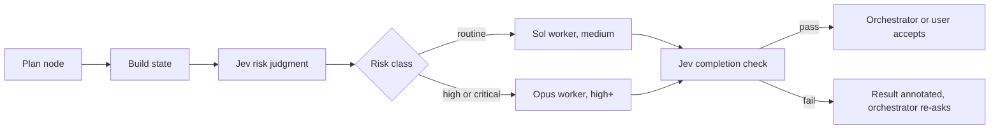
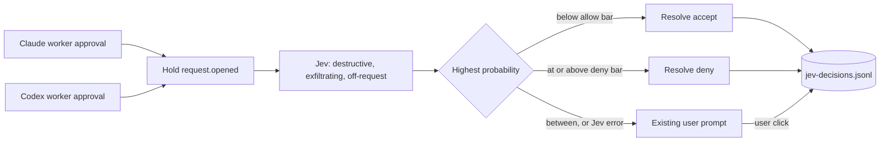
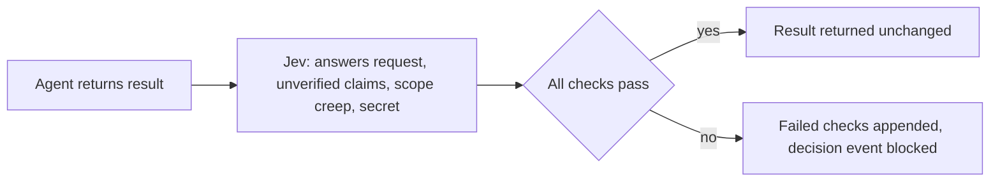

# AI-Native Coding Shell — Build Plan

This folder contains a build plan for a cross-platform, Electron-based coding shell focused on AI-assisted work orchestration rather than traditional editor-first development.

## What this package contains

1. [`docs/01-product-decisions.md`](./docs/01-product-decisions.md) — fixed product decisions from discovery
2. [`docs/02-architecture.md`](./docs/02-architecture.md) — system design, data model, module boundaries
3. [`docs/03-roadmap-phases.md`](./docs/03-roadmap-phases.md) — phased delivery plan, milestones, rough estimates
4. [`docs/04-ticket-backlog-foundations.md`](./docs/04-ticket-backlog-foundations.md) — phases 0–2 tickets
5. [`docs/05-ticket-backlog-core-panes-and-ai.md`](./docs/05-ticket-backlog-core-panes-and-ai.md) — phases 3–4 tickets
6. [`docs/06-ticket-backlog-notifications-multiwindow.md`](./docs/06-ticket-backlog-notifications-multiwindow.md) — phases 5–6 tickets
7. [`docs/07-execution-order.md`](./docs/07-execution-order.md) — strict order of execution, dependencies, critical path
8. [`docs/08-risks-cuts-open-questions.md`](./docs/08-risks-cuts-open-questions.md) — risk register, cut lines, things to defer
9. [`docs/09-beads-execution-plan.md`](./docs/09-beads-execution-plan.md) — execution plan for beads, Bun, Vite, React Doctor, and Biome
10. [`docs/decisions/README.md`](./docs/decisions/README.md) — accepted decision log and locked scope docs

## Product summary

The product is:

- an **AI-native coding shell**
- **cross-platform**
- **Electron-first**
- **workspace-first**
- **pane-oriented**
- optimized for:
  - chat
  - terminal
  - git
  - preview
  - jobs/notifications
  - light editor use

It is **not**:

- a full browser
- a full traditional IDE
- a window manager
- a VS Code replacement on day one
- a TUI wrapper

## Core user-facing model

```text
Project
  Workspace
    Layout
      Pane
```

Notes:

- `Project` is grouping and metadata.
- `Workspace` is the first-class working unit.
- A workspace is typically backed by a Git worktree.
- A workspace can exist in **only one window at a time**.
- Notifications target the **workspace level**.
- `Layout` is a split tree.
- `Pane` is a typed tool surface: chat, terminal, git, preview, editor, logs, jobs.

## Core product constraints

- Use battle-tested components wherever possible.
- Do not build a custom editor engine.
- Do not build a custom terminal engine.
- Do not build a full browser.
- Keep preview limited to app/runtime surfaces.
- Build the differentiation in:
  - workspace model
  - pane layout
  - navigation
  - job orchestration
  - notification UX
  - provider adapter layer

## Suggested reading order

1. Product decisions
2. Architecture
3. Roadmap phases
4. Ticket backlogs
5. Execution order
6. Risks and cut lines

## Jev gates

Aide uses TypeSafe's Jev decision model beneath every orchestrator turn. Jev answers typed
questions about a piece of state and returns probabilities, never text. Three question types
exist: Noul (yes or no with a probability), Choice (one option from a list, with a probability
per option and a confidence), and Score (a position on an ordered rubric). All questions in one
request share the state and cost about the same as a single question.

The rule every gate follows: Jev judges, code owns thresholds and side effects, generative
models write, and the user sets what is acceptable. Jev never accepts a plan node, never
merges, and never writes.

### The gates

| Gate              | Where it runs                                                                                        | Jev decides                                                                             | Code does                                                                                                                     |
| ----------------- | ---------------------------------------------------------------------------------------------------- | --------------------------------------------------------------------------------------- | ----------------------------------------------------------------------------------------------------------------------------- |
| Tool call gate    | Every approval request from a Claude or Codex worker, in the main process before the prompt is shown | Three Nouls: destructive, exfiltrating, off-request                                     | Auto-allow when all three are under the allow bar, auto-deny when any clears the deny bar, otherwise the existing user prompt |
| Lane routing      | Before an agent consultation is dispatched                                                           | Five Nouls: money, schema, infrastructure, taste, investigation                         | Raises the fleet risk class to the highest of the orchestrator's and Jev's, which sets the worker effort                      |
| Completion check  | After an agent returns its result                                                                    | Four Nouls: answers the request, claims unverified work, scope creep, contains a secret | Appends the failed checks to the result the orchestrator reads and records a blocked decision event                           |
| Context relevance | Before every turn                                                                                    | One Noul per retrieved candidate                                                        | Delivers only the relevant candidates                                                                                         |

The gates are provider independent. Each backend emits the same runtime event for an approval,
so a new provider only has to emit that event.

Every gate fails to the current behavior. A Jev error, timeout, rate limit, or missing key means
the gate does nothing and the existing path runs. A gate can remove clicks, never add risk.

### Configuration

Three layers, later wins per field, blank fields inherit:

1. Global: Settings, "Jev gates" section. Stored in `jev-gates.json` in user data.
2. Workspace: the Jev setup panel above the chat composer. Stored in the same file, keyed by workspace root.
3. Chat: the "Jev gates" button beside the permission mode in the composer. Stored with the session.

All gates ship off. Defaults: tool gate allow below 0.10 and deny at or above 0.90, lane routing
high at 0.60 and critical at 0.85, completion check minimum pass 0.50. Set thresholds from the
decision log, not from feel.

### Decision log and cost

Every judgment appends one JSON line to `jev-decisions.jsonl` in user data with the gate, the
probabilities, the thresholds that applied, and the decision. When Jev declines to decide a tool
request and the user clicks, that click is logged against the same request id. This is the
calibration data for per-question thresholds. Each call also reports usage under the `jev`
provider, so the fleet drawer scorecard includes it. The model version is pinned in
`src/main/jev-client.ts`; thresholds do not transfer across versions.

### Flows

Fleet dispatch with Jev routing:



Provider-agnostic tool call gate:



Completion check:



### Where the code lives

- `src/shared/jev-gates.ts`: settings model, defaults, layer resolution.
- `src/main/jev-client.ts`: the `ask` call for all three question types.
- `src/main/jev-gates.ts`: the questions and the judgments.
- `src/main/jev-gate-settings.ts`: global and workspace persistence.
- `src/main/managed-session-manager.ts`: the gate interception, risk routing, and completion check.
- `src/renderer/src/components/JevGateControls.tsx`: the control shared by all three layers.

### Known limits

- Jev returns numbers, never a reason. Debugging a decision means reading the questions and the log.
- Jev cannot see the filesystem. Deleting a temp file and deleting the database look alike if the path does not say so. The middle band and the user prompt cover that gap.
- Only the Noul answer shape has been exercised against the live API in this repository. Choice and Score follow the published docs.
- Per-tool thresholds, bounce classification of CI failures, and chat intent routing are not built. Add per-tool bars once the log shows Bash and Edit want different ones.

## License

MIT. See [LICENSE](LICENSE).
