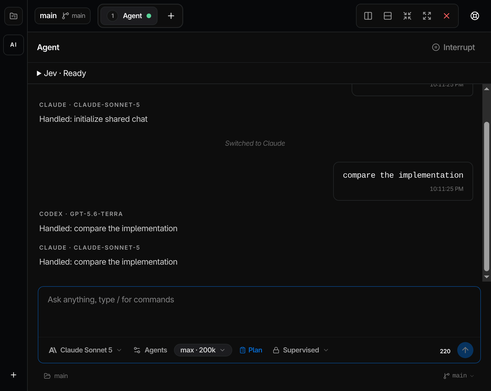

# Aide production readiness

Assessment date: 2026-09-17. Integration branch: `codex/product-readiness`.

## Verdict

Shared model conversations and required Jev preparation are implemented. Public
production distribution is not verified. All 24 Electron acceptance tests pass. A fresh Linux AppImage passes launch,
restart, native terminal, offline renderer, single-instance, and corruption
recovery checks. Team dogfood remains open.

The feature contract is the
[shared-model chat PRD](prd/shared-model-chat-and-context-preparation.md).

## Implemented behavior

| Area | Behavior | Verification |
| --- | --- | --- |
| Orchestrator | The selected Claude or Codex model owns the conversation and tool permissions. | Real provider calls and runtime tests. |
| Jev | Required preparation precedes model dispatch. Missing credentials, consent, or preparation failure stops dispatch. | Client, retrieval, preparation, and setup tests; live Jev requests. |
| Agent opinions | Up to two configured aliases receive the same pre-response history through `@` mentions. Each response keeps its model identity, usage, error, retry, and cancellation state. | Routing, partial failure, cancellation, history, and accounting tests. Electron acceptance passes. |
| Agent permissions | Opinion agents receive supplied evidence and cannot execute tools. Provider subprocesses do not receive the Jev credential. | Policy tests and live Claude/Codex permission probes. |
| Provider switching | A fresh provider receives retained user and assistant messages. Hidden reasoning and approval state are excluded. | A live Claude-to-Codex conversation recalled a synthetic fact. |
| Persistence | SQLite stores conversation snapshots and configuration. Restart marks unfinished work as interrupted without replaying commands. | Database and manager tests; renderer reattachment acceptance. |
| Accounting | Usage retains actual provider/model identity, cached-token fields, reported costs, and separate Jev usage. | Runtime, persistence, and parallel opinion tests. |
| IPC | The main process validates trusted renderer calls and workspace ownership. File reads reject paths outside the workspace. | Security, path, and terminal ownership tests. |
| Release gate | Release tags require successful CI for the exact commit. Pending, skipped, and unrelated results fail the gate. | Packaging workflow tests. |

## Using shared model chat

Open an Agent pane and complete Jev setup for the workspace. The model selector
sets the default orchestrator. The Agents control assigns models to the configured
aliases. Messages without recipients go to the orchestrator. Type `@` at the
start of a message to choose one recipient, or switch to Plan and choose two for
separate opinions. Selecting recipients does not change the default model.

Jev is required beneath the orchestrator and agents. Opinion agents receive
prepared workspace excerpts and conversation history. They cannot run tools or
modify files. Model errors retain successful responses; retry and interrupt
controls apply to individual recipients.

## Evidence

The pinned Node `24.17.0` and Bun `1.3.14` binaries were downloaded and checked
against their published SHA-256 values. The pinned toolchain runs locally.

| Check | Recorded result |
| --- | --- |
| Unit suite | 512 tests passed across 86 files, including security and persisted-state recovery. |
| File-access and terminal checks | 23 tests passed after workspace and symlink restrictions. |
| Build | TypeScript, renderer/main bundles, and runtime import validation passed. |
| Biome | Passed with 16 existing warnings and 2 informational findings. |
| Packaging scripts | 33 tests passed. |
| Dependency policy | Passed; frozen-lockfile installation preserves the lockfile. |
| Dependency audit | No high or critical advisories; 40 lower-severity advisories remain. |
| Renderer budget | Passed with 1,110 kB initial JavaScript and 516 kB CSS. |
| Electron | 24 tests passed, including approvals, shared-model responses, cancellation, restart, recovery, and updates. |
| Fresh Linux package | AppImage launch, native terminal, single-instance ownership, offline renderer, restart, and backup restoration passed. |

[Live verification evidence](verification/shared-model-live-smoke-2026-09-17.json)
records synthetic tests against real Jev, Claude, and Codex services. Codex
opinion tests rejected a forbidden file write and excluded project MCP servers.
A real managed conversation preserved a synthetic fact across Claude and Codex.
These checks establish connectivity and specific behavior, not general model
accuracy or token savings.

[Live orchestrator delegation](verification/orchestrator-delegation-live-2026-09-17.json)
completed in 16.8 seconds. Claude Opus 5 called the configured Codex
`gpt-5.6-luna` agent exactly once, received the synthetic fact, and returned the
expected answer. Both Jev preparation calls retained their usage reports.

The [Linux package smoke evidence](verification/linux-package-smoke-2026-09-17.json)
comes from the executable extracted from the new AppImage. The check imports a
synthetic project, executes a native terminal command, restarts the app, rejects
a second instance, corrupts its disposable database, and restores the project
from a backup. It also checks that renderer reload makes no HTTP requests.

Run the same check against an extracted package with
`node scripts/smoke-packaged-linux.mjs /absolute/path/to/aide` on Linux with a
display. The script creates an isolated temporary profile and writes its proof
and screenshot there. It does not touch the normal Aide profile.

## Release gates still open

1. Run team dogfood and the PRD's paired task evaluation. Measure answer quality,
   latency, token usage, and failures before making Jev savings claims.
2. Provision owned release hostnames, protected signing inputs, and the OTA
   health service. The Worker configuration contains deployment placeholders.
3. Verify signed bootstrap, upgrade, revocation, and recovery on each supported
   target. Native macOS signing and notarization require macOS acceptance.

The GitHub repository is private. Its release listing is empty. Main branch
protection and protected release configuration are absent in the inspected
repository settings. Public installation and OTA readiness therefore remain
unproven even when local feature checks pass.

The beads epic `aide-7ju` tracks implementation and acceptance. Damaged-state
recovery and desktop security use `aide-dfe.2` and `aide-dfe.3`. React Doctor's
newer-version findings and the existing Electron teardown failure remain tracked
separately. Release readiness is determined by these checks, not a percentage
of closed tickets or an unverified delivery date.
