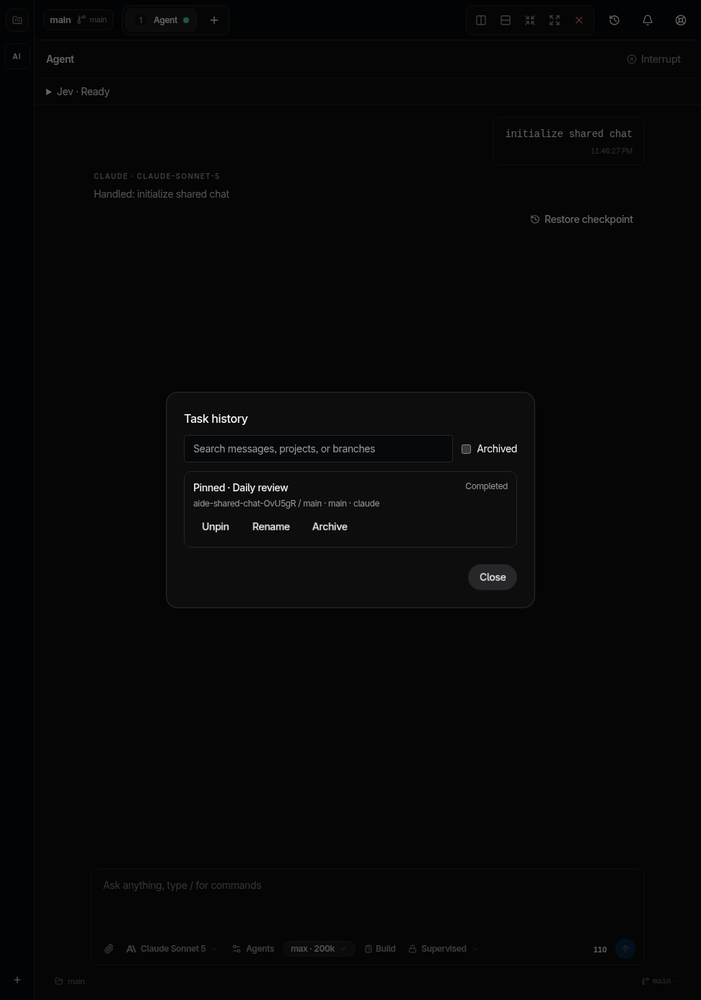
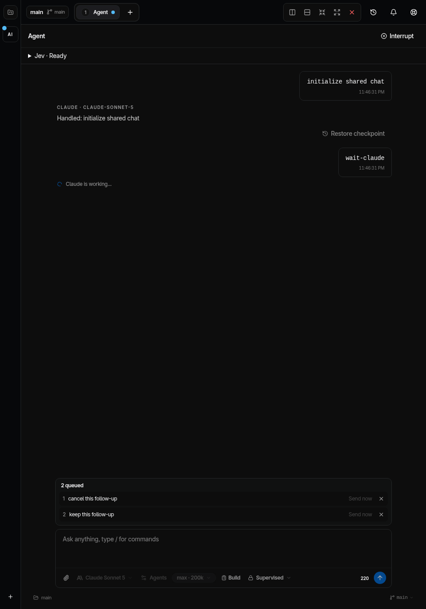
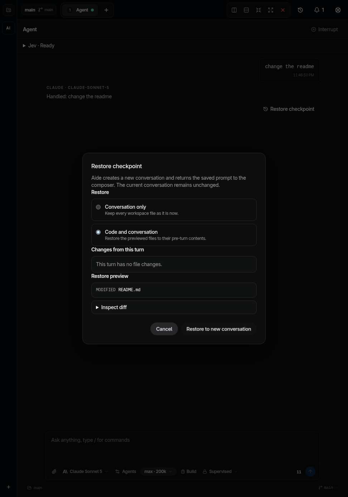
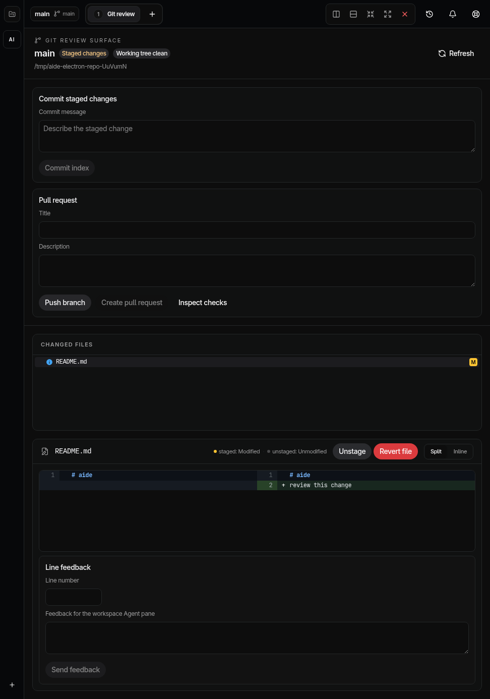

# Daily workflow verification

Assessment date: 2026-09-17. Branch: `codex/daily-workflows`.
Contract: [Daily agent workflows](prd/daily-agent-workflows.md).

## Implemented workflows

| Workflow      | Behavior                                                                                                                                                                 | Evidence                                                                                                                           |
| ------------- | ------------------------------------------------------------------------------------------------------------------------------------------------------------------------ | ---------------------------------------------------------------------------------------------------------------------------------- |
| Attachments   | Paste or drop images and select explicit workspace files. Validate size, MIME, workspace ownership, symlinks, and opened-file identity before sending verified payloads. | Provider payload tests, parent-directory swap regression, Electron file selection and 10 MB draft reload.                          |
| Follow-ups    | Persist ordered messages, cancel queued work, resume interrupted queues explicitly, and steer an active Codex turn.                                                      | Queue ordering, cancellation during preparation, ambiguous dispatch, checkpoint completion, full app restart, and steering checks. |
| Drafts        | Store text, recipients, and images in IndexedDB. Failed hydration keeps editing disabled until Retry succeeds.                                                           | Electron reload with two 5 MB images.                                                                                              |
| Checkpoints   | Inspect turn changes and exact restore diffs. Restore into a new conversation while retaining the original.                                                              | Disposable Git tests for stale previews, dirty files, ignored paths, symlinks, workspace identity, and file recovery.              |
| Restore retry | Retry opening an already-restored conversation without repeating file restoration.                                                                                       | Electron injects draft-storage failure, edits the restored file, retries, and checks that the edit survives.                       |
| Git review    | Send line feedback, stage, unstage, preview revert, commit, push, create a PR, and inspect checks.                                                                       | Real disposable Git mutations and controlled GitHub command tests. Tests do not publish remote branches or PRs.                    |
| Activity      | Show approvals, input requests, failures, interruptions, and paused queues. Persist read state and background-notification preferences.                                  | Main-process persistence and notification tests plus Electron inbox checks.                                                        |
| History       | Search saved user and assistant text, rename, pin, archive, restore, and open the owning pane.                                                                           | SQLite tests and Electron archive/reopen journey.                                                                                  |

Jev remains required beneath the orchestrator and agents. Explicit files bypass
optional relevance ranking but retain validation and required Jev preparation.
Opinion agents retain their existing read-only tool policy.

Checkpoint restoration and internal Git file mutations share workspace exclusion.
Restore rejects running agent work and workspace setup. Setup cannot start during
restoration. External editors and shell commands do not participate in this lock.

## Checks

The pinned Node 24.17.0 and Bun 1.3.14 toolchain runs these checks locally.

| Check                   | Result                                                                       |
| ----------------------- | ---------------------------------------------------------------------------- |
| Node unit suite         | 549 tests across 90 files pass.                                              |
| Electron acceptance     | 32 journeys pass. Providers and Jev responses are synthetic in this suite.   |
| Build                   | TypeScript, main/renderer bundles, and runtime import validation pass.       |
| Biome                   | No errors; 16 existing warnings and 2 informational findings remain.         |
| React Doctor 0.7.1      | Exits successfully with 203 warnings. This is not a clean diagnostic report. |
| Packaging configuration | 33 tests pass.                                                               |
| Dependency policy       | Policy and policy tests pass.                                                |
| Dependency audit        | High/critical advisory gate passes. Lower-severity advisories remain.        |
| Renderer budget         | Passes at approximately 1,198 kB initial JavaScript and 517 kB CSS.          |

The native Electron review uses Playwright against Aide's preload bridge.
These are Electron screenshots, not a Brave browser review.

The Linux desktop test launcher fixes its device scale to 1. The X11 test session
inherits `GDK_SCALE=2` on this machine; native Wayland reports scale 1. Product
font sizes are unchanged.

## Desktop evidence

## Fleet and Jev

| Agent                        | Model and effort    | Responsibility                                          |
| ---------------------------- | ------------------- | ------------------------------------------------------- |
| Boole / `daily_checkpoints`  | GPT-5.6 Sol, high   | Checkpoints, IndexedDB drafts, final integration review |
| Confucius / `daily_composer` | GPT-5.6 Sol, high   | Attachments, queue, steering, composer                  |
| Wegener / `daily_review`     | GPT-5.6 Terra, high | Git review, security regressions, mutation exclusion    |

The orchestrator owns integration, history, activity, desktop acceptance, and
visual review. Worker branches are `codex/daily-checkpoints`,
`codex/daily-composer`, and `codex/daily-review`.

[Jev implementation evidence](verification/daily-workflows-jev-2026-09-17.json)
records live excerpt classification with `jev-1.13.0`: 12,802 input tokens,
548 output tokens, and 1.189 seconds. The orchestrator checked the selections.
No development token savings or general accuracy improvement is measured.

## Release limits

These checks support a local Linux pilot. Public release provisioning, signed
updates, native macOS acceptance, and team dogfood remain open in
[Production readiness](19-production-readiness.md#release-gates-still-open).
