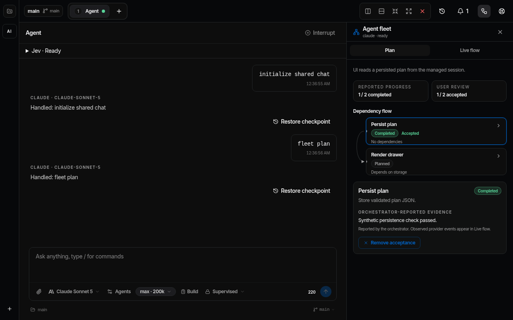
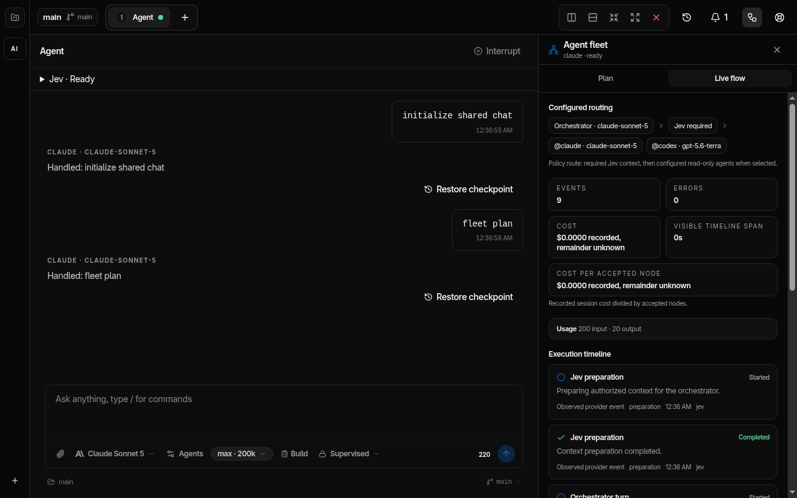
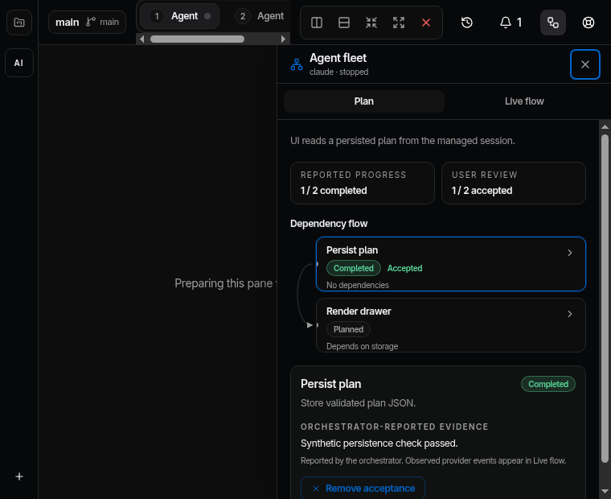

# Fleet drawer verification

Verified on Linux on 2026-09-18 for bead `aide-7kw`.

## Behavior

The Agent fleet toolbar button opens Plan first. The graph shows dependencies,
reported completion, selected-node evidence, and explicit user acceptance.
Live flow shows configured models, observed preparation and consultation events,
routing explanations, per-attempt numbers, usage, and recorded cost allocation.
Missing provider usage or prices keep total cost incomplete.

Main validates plan tools and persists fleet state in the existing session JSON.
Acceptance survives restart without starting a provider. Changed nodes invalidate
their acceptance and dependent acceptance. Unrelated accepted nodes remain intact.
Planned consultations require a node id and stop at the persisted attempt limit.
Different task titles or dependencies reset the count for a reused node id.

## Checks

- Node 24.17.0 Vitest: 585 tests across 93 files passed with global Git config disabled.
- The real Claude MCP transport advertised the plan schema, accepted a valid plan,
  and rejected a dependency cycle before calling the manager.
- TypeScript and the production build passed.
- Biome passed with 16 existing warnings and two informational findings.
- React Doctor 0.7.1 completed with zero errors and 218 advisory warnings.
- Renderer budget passed: initial JavaScript 1230.96 kB and CSS 520.00 kB.
- Electron suite: 32 passed on the first run. The existing workspace setup journey
  lost sidebar focus, then passed when rerun alone. All 33 journeys passed across
  those runs. The drawer journey passed on both focused and suite runs.
- Drawer checks cover Plan-first navigation, node selection, disabled acceptance,
  Live flow, unknown costs, Escape and focus return, pane isolation, restart,
  and a narrow viewport.
- Screenshots were inspected at 1280 by 800 and 760 by 620. Provider responses in
  the screenshots are synthetic test fixtures.

## Fleet and Jev

Sol high implemented the shared policy and drawer in separate worktrees.
Terra high implemented the provider tools and reviewed the integrated UI.
The root agent integrated main-process state, IPC, persistence, and desktop tests.
Independent review found three runtime defects; regression tests cover each fix.

Jev 1.13.0 classified the persistence boundary and opinion permission constraint.
The request took 0.882 seconds with 6568 input tokens and 72 output tokens.
The complete result is in `verification/fleet-drawer-jev-2026-09-18.json`.
This measurement does not establish a speed or cost saving against a baseline.

## Screenshots

## Remaining scope

`aide-3zf` tracks cost-complete budget admission. The current scorecard reports
known costs without promising a hard dollar spending cap. Opinion agents retain
their existing read-only permissions. Coding-worker worktrees and public release
signing remain separate from this drawer.
