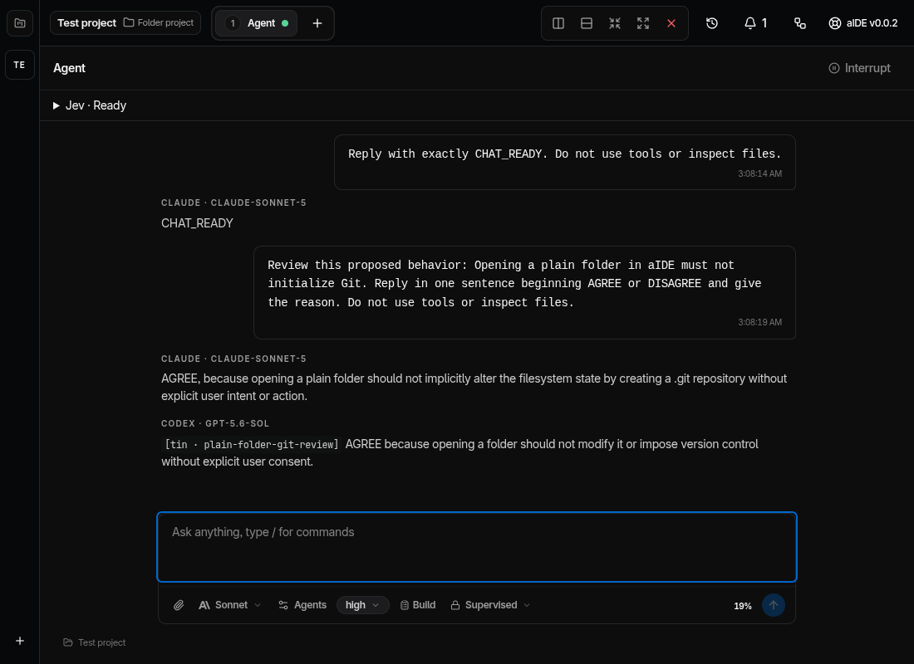
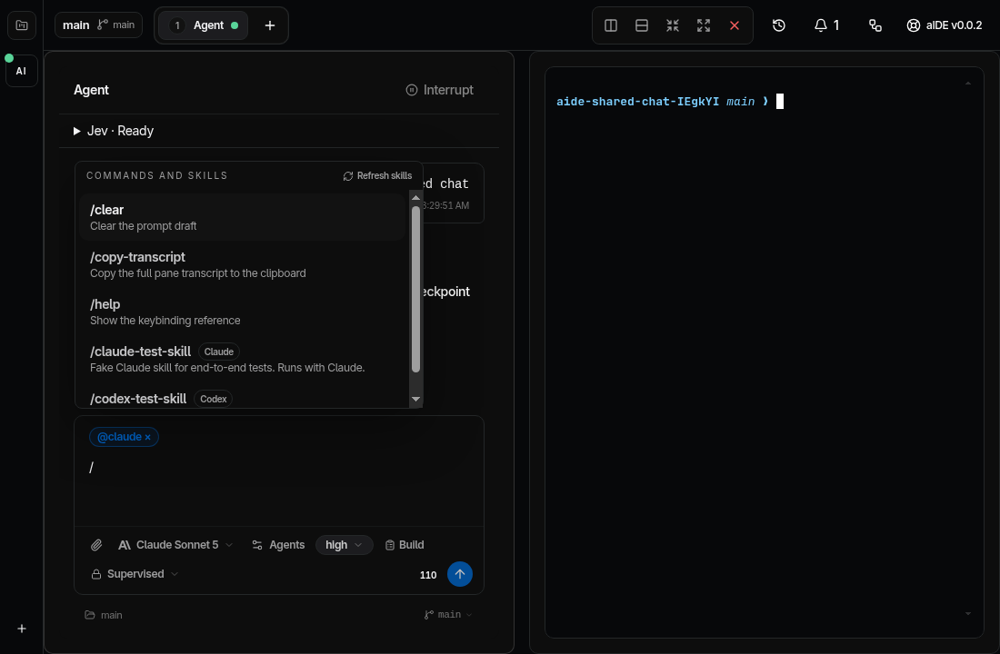
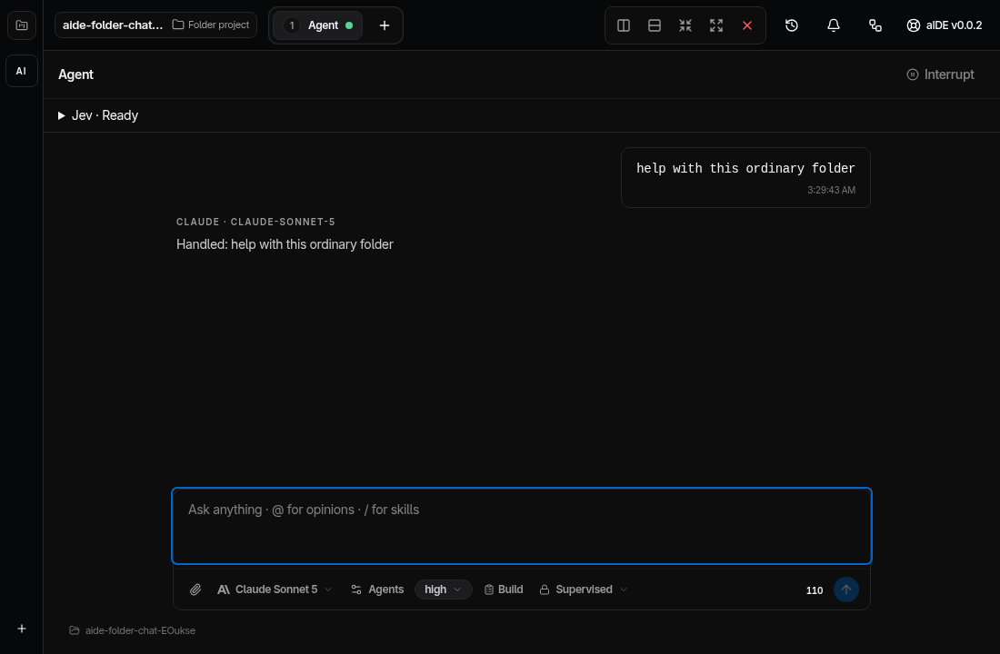

# Chat and provider skills

Verified on Linux on 2026-09-18 for bead `aide-nzl`, version `0.0.2`.

## Chat

`@Claude` and `@Codex` request opinions from the configured models in Build or
Plan. Opinion sessions remain read-only. Replies retain their provider and model
labels in the shared conversation. Both models receive the shared context through
required Jev preparation.

The native Claude catalog comes from the installed SDK. Codex models come from
the installed app-server. Model and skill selection waits for model discovery.
The Send button and Enter use the same readiness condition.

Jev setup has a Close button and Escape dismissal. Saving a ready configuration
collapses the panel. Missing credentials and missing workspace permission have
separate labels. A blocked send keeps the draft in the composer.

## Provider skills

Type `/` to search commands and skills. Each skill names its provider. Selection
switches the conversation to that provider and shows an `@Claude` or `@Codex`
skill chip. Selecting a skill clears opinion recipients. Sending uses the selected
provider's native skill invocation. Selecting another provider removes an
incompatible skill with an explanation.

Claude discovery uses `reloadSkills()`. Codex uses `skills/list`. Refresh reloads
the workspace catalog. Catalog failures have separate provider messages.
Codex skill IDs distinguish identical names from different native paths.
The main process resolves selected IDs and rejects unavailable skills,
wrong-provider inputs, and combinations with opinion recipients.

Skill drafts survive renderer reload. Queued skills survive app restart and stay
paused for review. A provider switch cannot dispatch a queued skill to its wrong
owner. That rejection happens before checkpoint creation or Jev processing.

## Evidence

- 615 unit tests passed across 95 files.
- 34 packaging tests passed.
- All 37 Electron journeys passed across the full run and the corrected Jev
  assertion rerun. The assertion checks a preserved draft instead of a queue entry.
- TypeScript, production build, Biome, dependency policy, and renderer budget passed.
- The installed AppImage reports `0.0.2` through the stable launcher. It imports
  the reported folder without changing leftover Git metadata, discovers both
  native catalogs, and executes a real Claude skill. Packaged Claude uses its
  executable outside Electron's archive. See `verification/installed-v0.0.2-2026-09-18.json`.
- React Doctor completed with zero errors. Advisory findings include existing
  component size and effect patterns. The skills-menu scroll effect maintains
  keyboard visibility; catalog loading also handles restored drafts.
- The minimum 1100 by 720 viewport preserves the composer and Send button.
  A horizontal split keeps the skills menu inside its Agent pane.
- Escape dismisses skill search without deleting its text.
- Real Claude Sonnet 5 and Codex GPT-5.6 Sol both agreed that opening an ordinary
  folder must not initialize Git. See `verification/real-model-agreement-2026-09-18.json`.
- Real Claude Opus 5 and Codex GPT-6 Astra each executed their own synthetic
  workspace skill through Jev. See `verification/provider-skills-live-2026-09-18.json`.
  The final live screenshot timed out after both completed replies. The separate
  desktop fixture verifies the skills menu and owner chips.

Sol high implemented the renderer and live model catalog. Terra high implemented
native skills and reviewed the integration. The root agent verified real provider
calls, fixed the startup race, and checked the rendered layouts with pro-design.

## Screenshots

## Scope

These checks establish the listed local workflows. They do not establish public
release signing, cost-complete fleet admission, or nested repository ownership.
Beads `aide-3zf` and `aide-1pm` track the latter two workflows.
