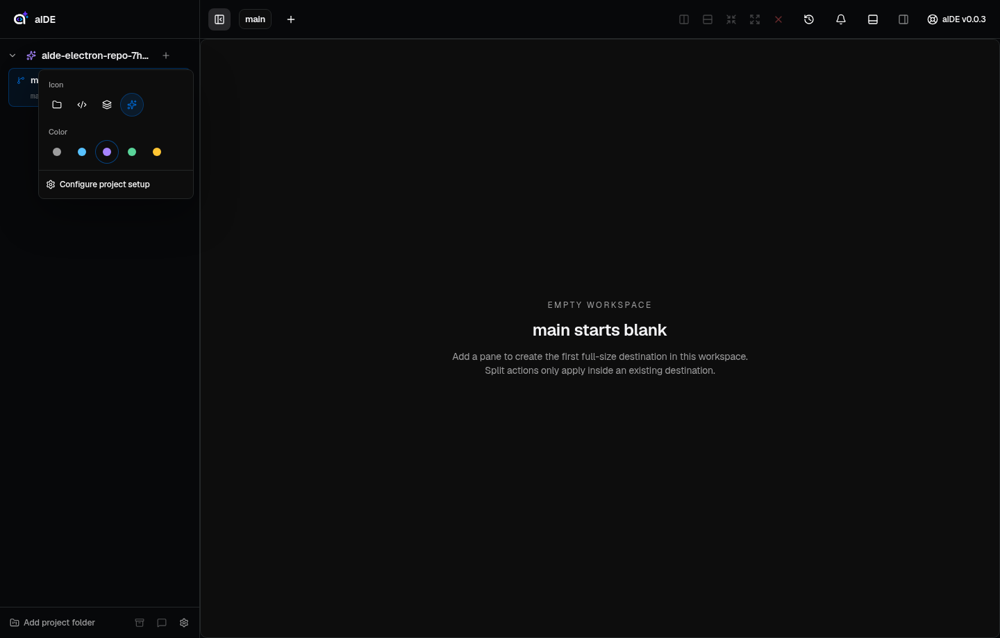
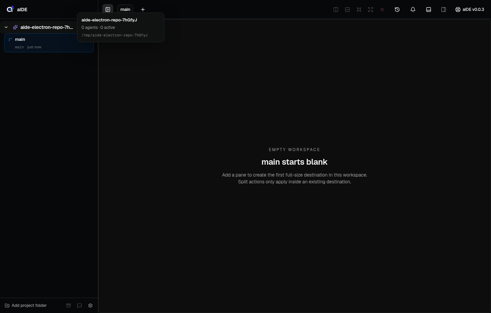
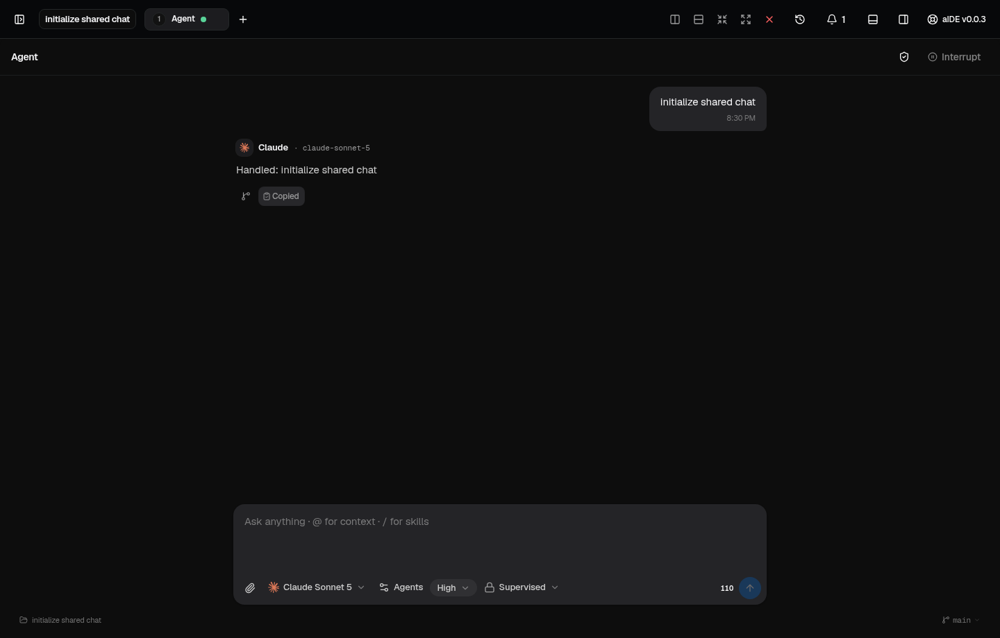

# Chat and sidebar verification

App version: 0.0.3. Verification date: 2026-09-18.

## Verified behavior

| Area               | Checks                                                                                                                                                                                                 |
| ------------------ | ------------------------------------------------------------------------------------------------------------------------------------------------------------------------------------------------------ |
| Composer           | Send clears the draft before provider completion. Failed sends restore an untouched draft without overwriting new text, recipients, files, or skills.                                                  |
| Mentions           | Inline results include agents, workspace files, and installed skills. Keyboard selection, trailing mentions, stale search cancellation, and removable attachments work.                                |
| Streaming          | Claude fragments form continuous responses. Codex response sections retain paragraph breaks. Timed streaming permits typing and menu use. Working labels follow the responding provider.               |
| Conversations      | Closing and reopening Agent restores the same workspace's transcript and draft. New chat starts separately. Branching copies the discussion through the selected response and preserves the source.    |
| Response actions   | Copy writes only assistant text to the desktop clipboard. Branch appears below completed responses. Conversation checkpoint buttons are absent.                                                        |
| Sidebar            | Rename persists independently of the Git branch. Right-click opens compact actions. Add sits beside the project name. Changes appear below the title. Hover details identify the branch and full path. |
| Project appearance | The entire header highlights on hover. Four icon presets and five colors persist after reload. Delayed hover shows project details.                                                                    |
| Pane controls      | Pane tabs and actions have no surrounding rounded container. Workspace indicators remain round. Closing a live terminal requires confirmation; cancel preserves the pane.                              |
| Settings           | Search, preferences, keyboard navigation, close/reopen, and draft preservation work. An injected Settings exception displays recovery controls without removing the app shell.                         |
| Providers          | Jev processing defaults to enabled and explicit opt-out persists. Claude SDK 0.3.268 bundles Claude Code 2.1.268, which passes the Fable 5.1 compatibility check.                                      |

## Checks

- 657 unit tests pass across 99 files.
- All 55 Electron scenarios pass across a 54-pass complete run and the corrected project-hover rerun. The rerun waits for popup dismissal before moving the pointer back to the project.
- Type checking and the production build pass.
- Biome reports no errors, 12 existing warnings, and two informational diagnostics.
- Initial renderer assets are 623.39 kB JavaScript and 447.01 kB CSS. Both bundle limits pass.
- Desktop tests run on isolated Xvfb display `:177` with temporary databases and synthetic provider responses.
- A separate live Fable 5.1 smoke request returns a response with the updated SDK. That request uses no tools or project context.

## Screenshots

## Remaining investigation

The live Settings incident records a renderer exception at 20:10:47 local, without a message or stack. The clean-build checks do not reproduce the original cause. The recovery boundary contains load and render failures; `aide-8mk` tracks identifying the original exception if it recurs.

The Electron suite verifies application behavior with synthetic providers. It does not establish live model quality or performance for arbitrary conversation sizes.
